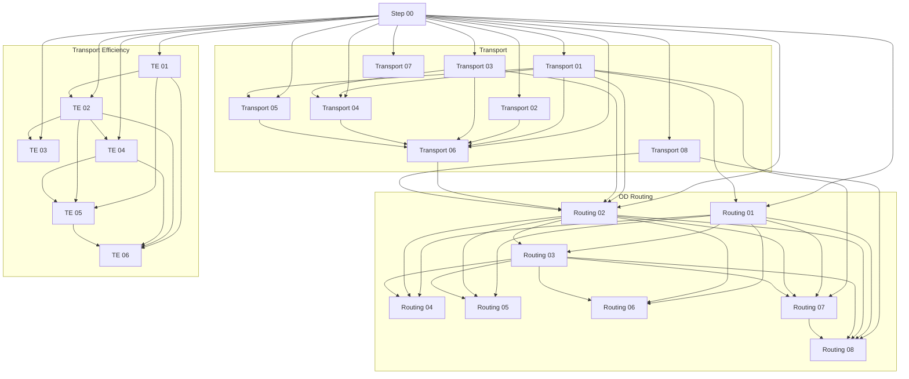

# Data Extraction Pipeline

This documentation describes the data processing pipeline step by step, detailing for each block **what transformations it applies** and **what output it produces**. A **dependency graph** is included at the end of the documentation, giving an overview of which steps rely on the output of other steps to run correctly.

## 1. Pipeline Steps

### Step 00 — Get the input data
The input data needed for the execution of the extraction pipeline is defined and downloaded in this step. The data are downloaded directly from the datalake and saved into the defined subfolder of the `data` folder. The script returns also the list of all available input data.

### Transport

#### Step 01 — Standardization of the road networks
Given the raw road network extracted from OpenStreetMap (OSM), this step process the data to get standardized versions of it. The standardization comprises the selection of relevant attributes, filtering of the relevant elements, imputation of missing but required attributes. At the end of the step, three road networks are generated:
- `geo`: the road network of significant streets from OSM, processed explicitely in the step
- `geo_all`: the road network of all streets from OSM,  processed explicitely in the step
- `dsf`: the road network processed with the simplification and imputation steps from the package `dsf-mobility`.

#### Step 02 — Computation of total flows entering/leaving the ZOI
In this step, the inter-zonal flows of the OD matrix are aggregated to obtain total flows in the ZOI. In particular, the step outputs the total number of passengers traveling:
- from ZOI to ZOI
- from ZOI to outside ZOI
- from outside ZOI to ZOI
- from outside ZOI to outside ZOI. 

Another aggregation of the OD matrix flows is used to generate the zonal startings, i.e., for each zone the number of passengers that start their trip in the zone.

#### Step 03 — Estimation of the inflow time series
The step aims at computing the vector of inflow in ZOI, i.e., the number of vehicles entering in the ZOI per each time instant. The information used for the estimation is extracted from the gate measures, and then processed to account for the missingness of the records.

#### Step 04 — Estimation of the outflow time series
The outflow from ZOI measures the number of vehicles exiting the ZOI per each time instant. The estimation of the outflow starts from loop and gate data: with the former, selecting the loop sensors in the proximity of the ZOI border, we estimate the inflow and outflow from the partial and limited information of the loops; with the latter, we correct the scale of the previous estimation, obtaining the outflow.

#### Step 05 — Estimation of traffic from loop data
The step implements a method for traffic computation that accounts only for the loop data. Making assumptions on the vehicles' average speed and on the congestion effects, we estimate the traffic for each road for each time instant, and by aggregation we compute the total traffic.

> **Note:** This steps is required only if the next step 06 uses the `scaling` method for traffic estimation, which requires the information on total traffic. This is not used in the default `probabilistic` method.

#### Step 06 — Estimation of starting and traffic time series
The goal of the step is to compute the vector of vehicles starting their trip in ZOI per each time instant (i.e., the startings) and the vector of vehicles circulating in ZOI per time instant (i.e., the traffic).

Two alternative methods are implemented for doing the task:
- the `probabilistic` version (default): models the system in a mathematical formulation of two equations for the conservation of the flows entering and starting, exiting and stopping. It outputs startings and stoppings given inflow and outflow.
- the `scaling` version: given the traffic from the previous step 05 and the total flows from step 02, computes traffic by rescaling, and starting/stopping by solving a dynamical sistem model.

In both cases, the traffic vector is then computed with a fixed point method to solve a dynamical system model, implemented in the `ts_solve` function.

Moreover, the steps computes the `P2V` parameter and saves it. It represents a conversion contstant from passengers to vehicles, inficating how many passengers travel per each vehicles, and is used to transform OD flows from passengers-based to vehicles-based.

#### Step 07 — Computation of indices for the Public Transport 
With this step, we compute zonal indices for the local public transport (PT). The indices account for: 
- availability of the service: looking at the capillarity of the PT coverage and the frequency of the rides
- convenience of the PT with respect to private vehicles: looking at the cost of the PT and at the temporal convenience of traveling in the two modes.

For the computation of the indices, we exploit the information in the PT operator websites: bus stop locations, bus ride frequency, routes, ticket cost. We also use OpenTripPlanner, a tool for simulating the trips of single vehicles given origin, destination, time and mode of transports, from whihc we obtained the time differences of trips.

#### Step 08 — Process emission data
The step uses the vehicular fleet data for the area of Bologna, and the emission model from EEA, to obtain the emission averages per euro-level, the euro-class split, and other information regarding emission computations.

> **Note:** The latter emission information is used in the last steps of the `od_routing` extraction pipeline, when computing emissions per roads with the non-linear approach. The implementation of this emission computation method in the simulation model is still WIP.

### Transport — OD routing

#### Step 01 — Road network preparation
The step prepares the road network for the traffic simulators, standardizing the data format to the one expected by the traffic simulators.

#### Step 02 — From OD flows to vehicles and platoons
With this step, we disaggregate the vehicular OD flows into single vehicles with origin, destination, and starting time. Platoons of vehicles are then generated aggregating single vehicles into groups: for mesoscopic traffic models, platoons are used; for microscopic traffic models, platoons of size of 1 are used.

The step computes also the node proportion quantity, used only for one of the simulators (dsf), assigning probabilities to each road newtork node given their presence as origins or destinations of vehicles.

The generation is performed multiple times, using multiple seeds.

#### Step 03 — Traffic simulation models
In this step, the traffic simulation occurs: synthetic vehicles generated in step 02 are let travel on the road network generated in step 01, and the output of the simulation records the trip of each synthetic vehicle. The simulation is performed multiple times, using multiple seeds.

There are three possible simulators to choose:
- uxsim
- fts (default)
- dsf

> **Note:** Although the output records trips of individual vehicles, the information is used only at the aggregated level in the subsequent steps. 

#### Step 04 — Estimate zonal flows
Given the output of the traffic simulator, we aggregate per each zone to obtain quantities per time interval:
- traffic per zone: measures the number of vehicles active in the zone per time interval
- inflow per zone from inside: measures the number of vehicles that enter the zone and started their trip in ZOI, per time interval
- inflow per zone from outside: measures the number of vehicles that enter the zone and started their trip outside ZOI, per time interval
- starting per zone: reports the number of vehicles starting their trip in the zone, per time instant

#### Step 05 — Estimate road-level flows
Given the output of the traffic simulator, we aggregate per each road to obtain the traffic per each time interval and other quantities (i.e., average speed, density, ...) 

#### Step 06 — Estimate trip-level flows
Given the output of the traffic simulator, we group the results per trip and compute relevant trip metrics, as the travel distance, the travel time, and quantities derivated from them.

#### Step 07 — Estimate parameter for the non-linear emission fit
Given the traffic and the vehicle velocity in each road segment in each time instant, we estimate their relationship throughout a parametric model. The estimation allows to predict new travel speed per each traffic condition, and is used in the next step 08.

#### Step 08 — Estimate road-level emissions
The step computes emissions at the road level using the non-linear approach. Given the traffic level of road segments, simulated from the previous step 03, we estimate the emission generated by vehicles in that road segment in that time instant. By aggregating, we obtain the emissions at the zone-level and at the ZOI-level.

> **Note:** The implementation supports the estimation of the emissions in new "what-if" scenario. Given a variation in the traffic $\Delta T$, we can estimate a variation in the velocity $\Delta v$, and recompute the emissions per road with the new velocity.

### Transport — Transport efficiency

#### Step 01 — Generate the grid of zones
The ZOI area is subdivided in an hexagonal grid with H3 resolution (~200m side length per element). The amenity POIs extracted from OSM are then assigned to each grid element, and the grid shapefile is enhanced with the information of how many POIs it contains. 

#### Step 02 — Assign the population to the grid
The step maps the population information currently available per statistical areas into the zoning grid created in the previous step. The redistribution is performed proportionally to the number of residential buildings in each grid.

#### Step 03 — Compute the travel time matrix of public transport
The output of the step is a NxN matrix, where N is the number of grid zones. Each element `(i,j)` represent the average travel time to reach the grid zone `j` starting from grid zone `i` when using only public transport (and walk) as a mode of transportation.

The computation uses the Connection Scan Algorithm (CSA), that starts from the GTFS file of the public transport system and computes the best ways to reach a destination given an origin. The CSA is executed between each bus stop. Then, the results are aggregated bewteen each grid zone by taking the minimum travel time among all trips starting inside a grid zone of origin and reaching a grid zone of destination. The algorithm is run multiple times, changing the starting hour of the trip, and the results are averaged.

#### Step 04 — Compute the travel time matrix of private vehicles
The output of this step is equivalent to the one of the previous step, but referring to private vehicles as a mode of transportation instead of public vehicles.

The computation exploits the Open Source Routing Machine (OSRM). It computes shortest paths in the OSM road network database between origin and destination grid zone centroids. The resulting travel times are then corrected to account for traffic conditions: `(1 + Δtraffic) * t_OSRM + 15 min` with `Δtraffic=0.22`.

#### Step 05 — Compute the private-vehicle dependency index
Using the travel times of public transport and private vehicle, the step obtains the opportunity scores per each mode of transport, per each grid zone. The opportunity scores are computed as proportional to the number of POIs reachable within a fixed temporal threshold.

Then, the private-vehicle dependency index per each grid zone is computed with the following formula:

$$(OS_{pv} - OS_{pt}) / (OS_{pv} + OS_{pt}) \,\,\mathbb{I}_{[OS_{pv} + OS_{pt}\neq0]}$$

#### Step 06 — Compute the population accessibility
Using the travel times of public transport and private vehicle, the step obtains the population scores per each mode of transport, per each grid zone. The population scores are computed as the sum of the population of each nearby grid zone weighted by a function of the time to reach that grid zone. 

### Ethics

Previously one step (`step_01_fragilities_preprocess`), now split so each step reads one
source and writes it at that source's natural grain, with the cross-source work at the end.

| Step | Output | What it does |
| --- | --- | --- |
| `step_01_reference_tables` | `quality_of_life_survey`, `MPI_weights`, `vulnerability_weights`, `sensibility_weights`, `income_indicators_directions` | Parameter material only; reads no source data |
| `step_02_zone_pums_crosswalk` | `map_as_zonepums` | Statistical area x OD zone, weighted by overlap |
| `step_03_fragility_index` | `ethics/fragility_index_by_area` | The published fragility index, unit fixes only |
| `step_04_population` | `ethics/population_by_area` | Resident population, used as the normalization weight |
| `step_05_social_services` | `ethics/social_services_by_area` | Service users over their denominator, per category |
| `step_06_family_structure` | `ethics/family_structure_by_area` | Lone-parent shares and the incidence of families with a minor |
| `step_07_redditi` | `ethics/redditi_by_area` | Median declared income by citizenship, sex, age band |
| `step_08_foreign_families` | `ethics/foreign_families_percentages`, `..._city` | Lone-parent families by citizenship |
| `step_09_legacy_indicator_tables` | `df_{category}_indicators_{gender}`, `df_{category}_MPI_{gender}` | Joins the partials back into the tables the model reads |

Steps 07 and 08 write the citizenship-bearing partials. No indicator reads them yet.

Step 09 is temporary. The model reads `df_{category}_indicators_{gender}.parquet`, so until it
assembles the partials itself something has to produce that shape. It is the tail of the old
step, moved unchanged, and reads only the outputs of the steps above it.

Steps 01-09 reproduce the 24 output files of the old step exactly, values and column order
included.

## 2. Architecture Overview
The extraction pipeline currently executes sequentially: by running all steps one after the other, all the output datasets are generated and saved successfully. 

However, there exists a dependency relationship between steps, some of which are independent from others given the input data, others require the completion of other step prior to execution. 

The following scheme depicts the dependency graph between steps, with arrows between boxes when the origin box is used in the destination box.

Another form of the graph: the dependency table

| Which step | Dependencies from other steps |
|---|---|
| Step 00 | None |
| Transport 01 | Step 00 |
| Transport 02 | Step 00 |
| Transport 03 | Step 00 |
| Transport 04 | Step 00; Transport 01, 03 |
| Transport 05 | Step 00; Transport 01 |
| Transport 06 | Step 00; Transport 01, 02, 03, 04, 05 |
| Transport 07 | Step 00 |
| Transport 08 | Step 00 |
| Routing 01 | Step 00; Transport 01 |
| Routing 02 | Step 00; Transport 01, 03, 06, 08 |
| Routing 03 | Routing 01, 02 |
| Routing 04 | Routing 01, 02, 03 |
| Routing 05 | Routing 01, 02, 03 |
| Routing 06 | Routing 01, 02, 03 |
| Routing 07 | Transport 01; Routing 01, 02, 03 |
| Routing 08 | Transport 08; Routing 01, 02, 03, 07 |
| TE 01 | Step 00 |
| TE 02 | Step 00; TE 01 |
| TE 03 | Step 00; TE 02 |
| TE 04 | Step 00; TE 02 |
| TE 05 | TE 01, 02, 04, 05 |
| TE 06 | TE 01, 02, 04, 05 |

